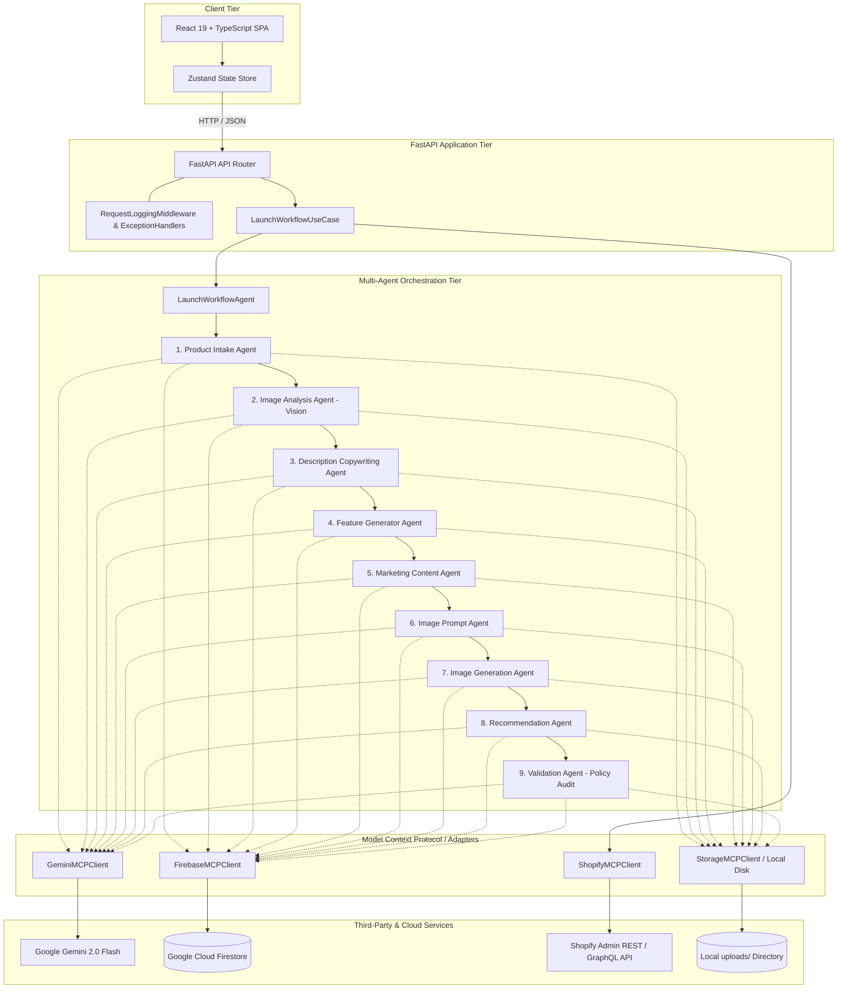
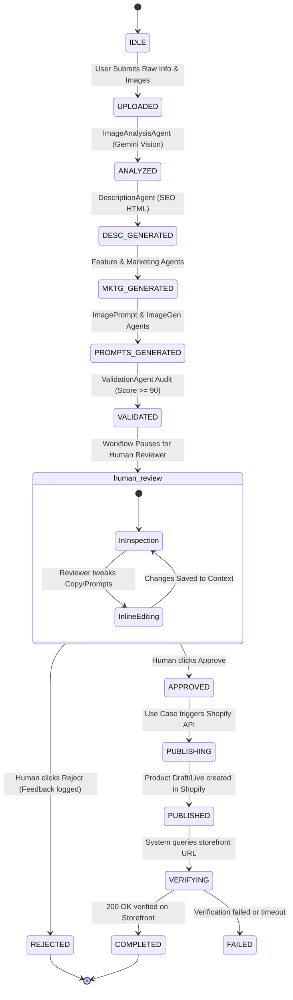

# AI Product Launch Studio (AI-PLP) — Complete Technical Interview Master Guide

> **Target Audience:** Technical Interviewers, Lead Architects, Staff Engineers, and Engineering Candidates.  
> **Repository:** `d:\AI-productLaunchAgent`  
> **Core Domain:** Enterprise Multi-Agent Catalog Generation, Multimodal Vision, E-Commerce Automation, and Human-in-the-Loop Workflow Publication.

---

## Table of Contents
1. [Project Executive Summary & Pitch](#1-project-executive-summary--pitch)
2. [High-Level & Low-Level Architecture](#2-high-level--low-level-architecture)
   - [Clean Architecture Layering](#clean-architecture-layering)
   - [System Architecture Diagram](#system-architecture-diagram)
   - [State Machine & Workflow Lifecycle](#state-machine--workflow-lifecycle)
3. [The Multi-Agent Orchestration Engine](#3-the-multi-agent-orchestration-engine)
   - [Why Multi-Agent vs. Monolithic LLM Call](#why-multi-agent-vs-monolithic-llm-call)
   - [Deep Dive: All 9 Specialized Agents](#deep-dive-all-9-specialized-agents)
   - [Canonical Product Context Pattern](#canonical-product-context-pattern)
   - [Model Context Protocol (MCP) Integration](#model-context-protocol-mcp-integration)
4. [Complete Tech Stack Breakdown & Justification](#4-complete-tech-stack-breakdown--justification)
   - [Backend Ecosystem](#backend-ecosystem)
   - [Frontend Ecosystem](#frontend-ecosystem)
   - [Storage & Cloud Infrastructure](#storage--cloud-infrastructure)
5. [End-to-End Execution Flow (Under the Hood)](#5-end-to-end-execution-flow-under-the-hood)
6. [Critical Design Decisions & Architectural Trade-offs](#6-critical-design-decisions--architectural-trade-offs)
7. [In-Depth Interview Questions & Answers](#7-in-depth-interview-questions--answers)
   - [Domain 1: System Architecture & Clean Architecture](#domain-1-system-architecture--clean-architecture)
   - [Domain 2: Agentic Workflows & LLM Engineering](#domain-2-agentic-workflows--llm-engineering)
   - [Domain 3: Backend, Concurrency & API Design](#domain-3-backend-concurrency--api-design)
   - [Domain 4: Data Persistence & Firestore Modeling](#domain-4-data-persistence--firestore-modeling)
   - [Domain 5: Shopify Integration & External APIs](#domain-5-shopify-integration--external-apis)
   - [Domain 6: Frontend Architecture & State Management](#domain-6-frontend-architecture--state-management)
   - [Domain 7: Security, Resilience & Failure Modes](#domain-7-security-resilience--failure-modes)
   - [Domain 8: Scalability & High-Throughput Production Roadmap](#domain-8-scalability--high-throughput-production-roadmap)
8. [High-Pressure Cross-Questions & Trap Questions](#8-high-pressure-cross-questions--trap-questions)
9. [Interview Cheat Sheet & Quick-Reference Soundbites](#9-interview-cheat-sheet--quick-reference-soundbites)

---

## 1. Project Executive Summary & Pitch

### 30-Second Elevator Pitch
> *"I designed and built the **AI Product Launch Studio**, a production-grade multi-agent platform that automates the end-to-end product onboarding lifecycle for e-commerce and educational STEM catalogs. By orchestrating eight specialized AI agents via Google Gemini 2.0 and the Model Context Protocol (MCP), the system ingests raw hardware photos and specs, runs multimodal vision analysis, generates SEO-optimized technical copy, creates marketing campaigns, synthesizes image generation prompts, runs an automated quality audit, and manages human approval before publishing directly to Shopify via the Admin API."*

### 2-Minute Deep Technical Pitch
> *"In modern e-commerce—specifically niche industries like KiddyPi educational robotics—launching a single product takes days of cross-functional friction: hardware engineers write rough specs, copywriters draft descriptions, marketers format multi-platform social posts, prompt engineers create marketing visuals, and catalog managers manually input everything into Shopify while checking safety policies.*
>
> *To eliminate this bottleneck, I architected a system grounded in **Clean Architecture** and **Event-Driven Agentic Orchestration**. On the backend, we use FastAPI (Python 3.12) with an 8-stage pipeline orchestrated by a `LaunchWorkflowAgent`. Each agent is isolated with single-responsibility boundaries, interacting through a shared **Canonical Product Context** and abstracted through **MCP (Model Context Protocol)** clients for Gemini, Firebase Firestore, and Shopify.
>
> *A key architectural principle was **zero-loss offline resiliency**: every service adapter has an in-memory or local mock fallback, so developers can test the entire pipeline without live credentials or external rate-limiting.*
>
> *On the frontend, React 19/18, TypeScript, and Zustand deliver a real-time **Human-in-the-Loop (HITL) Review Center** with live progress tracking, full copywriting editing, safety scores, and a synchronized **Demo Store** with category-aware recommendations."*

---

## 2. High-Level & Low-Level Architecture

### Clean Architecture Layering

The backend enforces strict Clean Architecture (Dependency Inversion Principle) where inner business layers have zero knowledge of external frameworks or network protocols:

```
┌─────────────────────────────────────────────────────────────┐
│                    INTERFACES LAYER                         │
│  - FastAPI Routers (/api/v1/workflows, /agent-workflows)    │
│  - Pydantic v2 Ingress Schemas & Request Models             │
│  - Custom Middleware (Request Logging, Timing, Error Maps)   │
└──────────────────────────────┬──────────────────────────────┘
                               │ calls
┌──────────────────────────────▼──────────────────────────────┐
│                    USE CASES LAYER                          │
│  - LaunchWorkflowUseCase (State transitions & audits)       │
│  - Orchestrator Coordination (Agent pipeline executor)      │
│  - Business logic independent of HTTP or DB drivers         │
└──────────────┬──────────────────────────────┬───────────────┘
               │ depends on                   │ coordinates
┌──────────────▼──────────────┐┌──────────────▼───────────────┐
│        DOMAIN LAYER         ││         AGENTS LAYER         │
│  - Pure Domain Entities     ││  - BaseAgent Lifecycle       │
│    (LaunchWorkflow, etc.)   ││  - 8 Specialized Agents      │
│  - Repository Interfaces    ││  - Canonical Context         │
│    (WorkflowRepository, etc)││  - Structured Pydantic Out   │
└──────────────▲──────────────┘└──────────────┬───────────────┘
               │ implements                   │ uses
┌──────────────┴──────────────────────────────▼───────────────┐
│                   INFRASTRUCTURE LAYER                      │
│  - GeminiMCPClient (Google GenAI SDK 0.1.1 + Multimodal)    │
│  - FirebaseMCPClient & FirestoreWorkflowRepository          │
│  - ShopifySessionManager & ShopifyAdminServiceClient        │
│  - Local Disk File Storage & Static File Mounting           │
└─────────────────────────────────────────────────────────────┘
```

### System Architecture Diagram



### State Machine & Workflow Lifecycle

The workflow moves through a deterministic, strictly validated finite state machine (`WorkflowState` Enum):



---

## 3. The Multi-Agent Orchestration Engine

### Why Multi-Agent vs. Monolithic LLM Call?

Interviewers always ask: *"Why didn't you just write one big prompt that takes the image and generates description, features, marketing copy, prompts, and validation all at once?"*

| Architectural Criterion | Monolithic Single LLM Prompt | Modular Multi-Agent Pipeline (Our Choice) |
|---|---|---|
| **Context Window Degradation** | Attention drifts across a 4,000-token prompt; late instructions (e.g., safety checks) get ignored ("lost in the middle"). | Each agent receives a focused, task-specific prompt with strict system instructions and isolated scope. |
| **Schema Reliability** | Single giant JSON schemas frequently fail parsing or truncate when outputting 3,000+ tokens. | Each agent outputs a small, strictly typed Pydantic schema validated individually via `response_schema`. |
| **Error Isolation & Retry** | If marketing copy hallucinates, the entire 60-second generation fails and must be re-run from scratch ($$$). | Failed steps can be retried independently without re-running vision or intake stages. |
| **Model Specialization** | Forced to use the most expensive model for trivial tasks (e.g., tag extraction). | Can route vision to multimodal models, copy to fast flash models, and validation to deep reasoning models. |
| **Auditability & Latency Tracing** | Zero visibility into which sub-instruction caused a latency spike or hallucination. | `BaseAgent` logs granular start, end, and execution duration per stage into Firestore logs. |

### Deep Dive: All 9 Specialized Agents

#### 1. Product Intake Agent (`ProductIntakeAgent`)
- **File:** `backend/app/agents/product_intake/agent.py`
- **Responsibility:** Normalizes and sanitizes messy user input before passing it downstream.
- **Under the Hood:**
  - Validates positive price values, required text strings, and array bounds.
  - Normalizes product categories against standard KiddyPi taxonomy (`Programming Courses`, `Robotics Kits`, `STEM Kits`, `Arduino Courses`, etc.).
  - Title-cases names, lowercases and deduplicates tags, and deduplicates learning outcomes.
  - Instantiates the `CanonicalProductContext` with a unique `workflow_id` (`wf-xxxxxxxx`) and `product_id` (`prod-xxxxxxxx`).

#### 2. Image Analysis Agent (`ImageAnalysisAgent`)
- **File:** `backend/app/agents/image_analysis/agent.py`
- **Responsibility:** Inspects uploaded image hardware components via multimodal vision.
- **Under the Hood:**
  - Reads image bytes from either local upload disk paths (`localhost:8000/uploads/...`) or external URLs using `httpx.AsyncClient`.
  - Converts raw binary to `google.genai.types.Part.from_bytes(data, mime_type)`.
  - Prompts Gemini Vision with `IMAGE_ANALYSIS_SYSTEM_INSTRUCTION` to extract: detected components (e.g. ESP32, breadboards, jumper wires), color palettes, physical materials, and style keywords.
  - Produces structured `ImageAnalysisResult`.

#### 3. Description Agent (`DescriptionAgent`)
- **File:** `backend/app/agents/description/agent.py`
- **Responsibility:** Crafts high-conversion, educational, SEO-optimized e-commerce copy.
- **Under the Hood:**
  - Ingests canonical metadata and the visual findings from `ImageAnalysisAgent`.
  - Produces an SEO meta-title (under 60 chars), SEO meta-description (under 160 chars), valid HTML body with heading tags (`<h2>`, `<ul>`), and high-intent search tags.

#### 4. Feature Generator Agent (`FeatureGeneratorAgent`)
- **File:** `backend/app/agents/feature_generator/agent.py`
- **Responsibility:** Extracts structured hardware/software specifications and educational breakdown.
- **Under the Hood:**
  - Generates four distinct blocks:
    1. `key_features`: Bulleted selling points (e.g., "Plug-and-play assembly, no soldering required").
    2. `specifications`: Key-value dictionary (e.g., Dimensions, Microcontroller model, Operating Voltage, Age suitability).
    3. `whats_included`: Box packaging manifest (e.g., "1x KiddyPi Microcontroller, 12x Color-coded sensors").
    4. `highlights`: Cognitive and STEM learning outcomes.

#### 5. Marketing Agent (`MarketingAgent`)
- **File:** `backend/app/agents/marketing/agent.py`
- **Responsibility:** Multi-channel omnichannel marketing asset generation.
- **Under the Hood:**
  - Generates platform-tailored social copy:
    - **Instagram:** Visual hooks, emoji usage, and targeted hashtags (`#KidsWhoCode`, `#STEMEducation`).
    - **Facebook:** Parent-focused value proposition emphasizing safety, screen-time reduction, and problem-solving skills.
    - **Twitter / LinkedIn:** Teacher and educator-focused copy emphasizing curriculum alignment.
  - Generates paid ad copy: Meta Ad headline + body; Google Search Ad headline + description.
  - Generates an email newsletter template with subject line and CTA button copy.

#### 6. Image Prompt Agent (`ImagePromptAgent`)
- **File:** `backend/app/agents/image_prompt/agent.py`
- **Responsibility:** Prompt engineering for downstream generative visual synthesis.
- **Under the Hood:**
  - Synthesizes detailed positive and negative prompts for diffusion/generative models (Vertex AI Imagen / Gemini).
  - Generates two prompt categories:
    - **Studio Packshot Prompts:** Clean white backdrop, commercial studio lighting, soft shadows, 45-degree angle, 8K hyper-detailed product photography.
    - **Lifestyle Scene Prompts:** Contextual action scenes showing a 9-year-old child happily interacting with the assembled kit in a bright, modern learning room.

#### 7. Image Generation Agent (`ImageGenerationAgent`)
- **File:** `backend/app/agents/image_generation/agent.py`
- **Responsibility:** Generates and delivers high-resolution visual assets.
- **Under the Hood:**
  - Returns three production-grade asset URLs:
    1. `packshot`: Isolated white-background product render.
    2. `lifestyle_scene`: Child-building contextual action shot.
    3. `promotional_banner`: Wide-aspect ratio marketing hero banner for web storefronts.

#### 8. Recommendation Agent (`RecommendationAgent`)
- **File:** `backend/app/agents/recommendation/agent.py`
- **Responsibility:** Catalog cross-selling and curriculum progression matching.
- **Under the Hood:**
  - Scans Firestore `sample_products` collection seeded with 20 educational kits and courses.
  - Executes category routing logic:
    - `Programming Courses` $\rightarrow$ Matches Python, Scratch, Web Development, and Algorithm kits.
    - `Electronics Courses` $\rightarrow$ Matches Arduino, Raspberry Pi, Micro:bit, and Sensor Explorer kits.
  - Slices top 4 matching products to power "Frequently Bought Together" recommendations in the Demo Store.

#### 9. Validation Agent (`ValidationAgent`)
- **File:** `backend/app/agents/validation/agent.py`
- **Responsibility:** Automated AI Quality Assurance, safety auditing, and policy check.
- **Under the Hood:**
  - Evaluates the entire accumulated context of the workflow.
  - Verifies: child COPPA compliance, absence of offensive language, grammar accuracy, readability rating (Flesch-Kincaid equivalent for target age group), and visual-to-copy consistency.
  - Produces a quantitative `validation_score` (0–100) and specific suggestions. Workflows scoring $\ge 90$ automatically transition to `human_review`.
  - Persists audit report to the Firestore `reports` collection.

---

### Canonical Product Context Pattern

A core design pattern in this architecture is the **Canonical Product Context** (`CanonicalProductContext` in `backend/app/agents/product_intake/schemas.py`).

```python
class CanonicalProductContext(BaseModel):
    workflow_id: str
    product_id: str
    product_name: str
    category: str
    price: float
    currency: str = "USD"
    age_group: str
    difficulty: str
    duration: Optional[str] = None
    language: str = "English"
    learning_outcomes: List[str]
    prerequisites: List[str]
    tags: List[str]
    uploaded_images: List[str]
    status: str = "draft"
    created_at: str
    updated_at: str
```

**Why is this pattern critical?**
- Prevents data schema drift across agents.
- Provides an immutable snapshot of normalized inputs that every subsequent agent reads from.
- Decouples downstream agents from how raw data was originally entered (e.g., CSV upload vs. manual form vs. webhook).

---

### Model Context Protocol (MCP) Integration

The project adopts the **Model Context Protocol (MCP)** specification pattern across four dedicated client adapters:

1. **`GeminiMCPClient` (`backend/app/agents/mcp/gemini_mcp.py`):**
   - Encapsulates Google GenAI SDK calls.
   - Enforces structured JSON output via `types.GenerateContentConfig(response_mime_type="application/json", response_schema=response_schema)`.
   - Handles inline binary multimodal conversion for image bytes.
   - Automatically degrades gracefully to `response_schema.model_construct()` if API keys are missing or invalid, preventing server crashes during offline local testing.

2. **`FirebaseMCPClient` (`backend/app/agents/mcp/firebase_mcp.py`):**
   - Abstract data broker for workflow documents, audit reports, and execution logs.
   - Maintains an in-memory class-level `_mock_db`, `_mock_logs`, and `_mock_reports` dictionary fallback when GCP credentials are not active.

3. **`ShopifyMCPClient` (`backend/app/agents/mcp/shopify_mcp.py`):**
   - Decoupled tool client allowing AI agents to query catalog presence and create draft products.

4. **`StorageMCPClient` (`backend/app/agents/mcp/storage_mcp.py`):**
   - Abstraction for file uploads, decoupling local disk mounting from Cloud Storage buckets.

---

## 4. Complete Tech Stack Breakdown & Justification

### Backend Ecosystem

| Technology | Version / Spec | Why Chosen? | Alternative Considered | Why Alternative Rejected |
|---|---|---|---|---|
| **Python** | 3.12 | Native async/await improvements, enhanced type hinting, superior AI/ML ecosystem. | Node.js / Go | Python is the undisputed standard for AI SDKs (Google GenAI, LangChain, PyTorch). |
| **FastAPI** | $\ge$ 0.111.0 | Asynchronous ASGI framework, automatic OpenAPI/Swagger generation, dependency injection. | Flask / Django | Flask is synchronous by default; Django is bloated with unnecessary ORM overhead. |
| **Pydantic** | $\ge$ 2.8.2 | Rust-backed performance (Pydantic Core), native JSON schema generation for LLM structured output. | Marshmallow / Dataclasses | Dataclasses lack runtime type validation; Pydantic v2 is $5\times\text{--}10\times$ faster. |
| **Google GenAI SDK** | $\ge$ 0.1.1 | Official lightweight SDK supporting Gemini 2.0 Flash with native multimodal structured output. | OpenAI / LangChain | Gemini 2.0 offers massive context windows, cheaper vision tokens, and lower latency. |
| **ShopifyAPI** | $\ge$ 12.4.0 | Official Python library handling OAuth session management and REST/GraphQL Admin endpoints. | Raw HTTP (httpx/requests) | Official SDK handles HMAC signature validation, session deactivation, and schema updates. |
| **Firebase Admin** | $\ge$ 6.5.0 | Server-side Firestore and Storage integration with real-time listeners. | PostgreSQL + SQLAlchemy | Firestore's schemaless document model fits evolving AI JSON outputs; zero migration overhead. |
| **Loguru & Logging** | $\ge$ 0.7.2 | Colorized, structured, thread-safe logging with microsecond execution duration tracing. | Standard `logging` alone | Standard logging requires verbose formatting configs; Loguru offers instant context tracing. |
| **Pytest & AnyIO** | $\ge$ 8.2.2 | Full asynchronous test coverage for async agent workflows and FastAPI `TestClient`. | Unittest | Pytest fixtures, parameterized tests, and anyio async support are far more productive. |

### Frontend Ecosystem

| Technology | Version / Spec | Why Chosen? | Technical Purpose |
|---|---|---|---|
| **React** | 18.3.1 / 19 | Industry-standard declarative component architecture. | Drives the entire SPA interface. |
| **Vite** | 5.2.11 | Sub-second Hot Module Replacement (HMR) via native ES modules and Rollup. | Fast build and development server. |
| **TypeScript** | 5.2.2 | Static type safety matching backend Pydantic models. | Prevents runtime null/undefined bugs. |
| **Zustand** | 4.5.2 | Hook-based, minimal boilerplate state management. | Manages active workflows, edit states, and session data. |
| **Tailwind CSS** | 3.4.4 | Utility-first styling with zero CSS bloat. | Rapid UI development and responsive design. |
| **Radix UI / Shadcn** | $\ge$ 1.0.0 | Accessible, unstyled primitives (Dialogs, Dropdowns, Cards, Toasts). | High-quality enterprise component foundations. |
| **Framer Motion** | 11.2.10 | Physics-based micro-interactions and smooth tab transitions. | Visual feedback during multi-agent pipeline progress. |
| **Axios** | 1.7.2 | Configurable HTTP client with interceptors and long timeouts (120s). | Communicates with FastAPI backend. |

### Storage & Cloud Infrastructure

- **Google Cloud Firestore:** NoSQL document database storing unified product workflow documents and audit reports.
- **Local Disk Static Mount (`UPLOADS_DIR`):** FastAPI mounts `backend/uploads` directly to `/uploads`, providing immediate HTTP URLs (`http://localhost:8000/uploads/...`) for newly uploaded images.
- **Docker & Docker Compose:** Multi-stage Dockerfiles for backend and frontend, enabling one-click local orchestration (`docker-compose up --build`).
- **GCP Cloud Run & Firebase Hosting:** Containerized serverless deployment target for the FastAPI container and global CDN hosting for the Vite static build.

---

## 5. End-to-End Execution Flow (Under the Hood)

Let's trace what happens when a user clicks **"Launch Product"** in the Dashboard:

```
[1. User Action] User inputs "Arduino Robot Kit Elite", $129.99, category "Arduino", attaches "board.jpg".
       │
[2. Frontend Ingress] Zustand triggers workflowApi.uploadImage(workflowId, file) -> Saves to disk as
       │              "{workflow_id}-{uuid}.jpg" -> URL: "http://localhost:8000/uploads/...".
       │
[3. Pipeline Trigger] Frontend calls POST /api/v1/agent-workflows with IntakeInput JSON payload.
       │
[4. Intake Execution] LaunchWorkflowAgent.execute_workflow() begins:
       │  - ProductIntakeAgent validates price > 0, normalizes category to "Arduino Courses".
       │  - Builds CanonicalProductContext and writes initial record to Firestore / mock DB.
       │
[5. Vision Execution] ImageAnalysisAgent loads image bytes from local disk, converts to inline Part,
       │  and sends to Gemini 2.0 Flash -> returns detected components, colors, and style.
       │
[6. Copy & Features] DescriptionAgent synthesizes SEO HTML body and tags.
       │  - FeatureGeneratorAgent extracts key features, hardware specs, and "What's Included".
       │
[7. Marketing & Prompts] MarketingAgent writes Instagram, Facebook, Meta/Google ad copy, and newsletter.
       │  - ImagePromptAgent engineers studio packshot and child-building lifestyle prompts.
       │  - ImageGenerationAgent binds packshot, lifestyle, and promotional banner URLs.
       │
[8. Recommendations] RecommendationAgent categorizes product as "Electronics" and pulls 4 matching
       │  products (Raspberry Pi, Micro:bit, Smart Sensors) from Firestore seed catalog.
       │
[9. Automated Audit] ValidationAgent inspects full context -> calculates score (94.5/100), checks safety.
       │  - State transitions to 'human_review'. Full consolidated document written to Firestore.
       │
[10. Human Review] Reviewer audits copy in HumanReview.tsx, modifies features or copy inline if needed.
       │  - Clicks "Approve & Publish".
       │
[11. Catalog Publish] Backend LaunchWorkflowUseCase.publish_to_shopify() creates Shopify Draft product
       │  via ShopifyAdminServiceClient (with graceful local catalog fallback).
       │  - verify_publication() verifies live URL -> marks state as COMPLETED.
       │  - Product immediately appears on live Demo Store (/store) with active buy buttons.
```

---

## 6. Critical Design Decisions & Architectural Trade-offs

### 1. Unified Single Document vs. Distributed Subcollections in Firestore
- **Decision:** We store each product launch as a single, consolidated document in the `workflows` collection (`workflow_id`), with an auxiliary document for `workflow_logs`.
- **Trade-off:**
  - *Pros:* Atomic updates, zero complex multi-table joins, single-round-trip read on the frontend (`getWorkflow(id)` gets all 8 agents' data in 1 network call).
  - *Cons:* Firestore has a 1MB document size limit.
  - *Mitigation:* We store image binary assets on disk / Cloud Storage and only keep URL strings in the document. The resulting JSON document is under 25KB, well within the 1MB limit.

### 2. Sequential vs. Parallel Agent Execution
- **Decision:** We execute Intake $\rightarrow$ Vision $\rightarrow$ Description $\rightarrow$ Features $\rightarrow$ Marketing $\rightarrow$ Prompts $\rightarrow$ Images $\rightarrow$ Recommendations $\rightarrow$ Validation sequentially.
- **Trade-off:**
  - *Why not parallelize?* Description depends on Vision output; Features depend on Description; Marketing depends on Features; Validation depends on *everything*.
  - *Optimization Opportunity:* In high-throughput settings, Marketing, Image Prompts, and Recommendations can run in parallel via `asyncio.gather()` once Description and Features finish.

### 3. Graceful Mock Degradation vs. Hard Service Failure
- **Decision:** Every MCP client and infrastructure repository has an automatic fallback to local memory or mock schemas when API keys or network endpoints are offline.
- **Trade-off:**
  - *Pros:* Developer onboarding is instantaneous (tests run with `pytest` without needing a paid Gemini key or Shopify store). System never crashes with an unhandled exception.
  - *Cons:* If an API key is accidentally misconfigured in staging, the system might generate mock data instead of alerting immediately.
  - *Mitigation:* Explicit `logger.warning()` alerts log whenever mock fallbacks trigger, and production environment checks can enforce strict validation.

---

## 7. In-Depth Interview Questions & Answers

### Domain 1: System Architecture & Clean Architecture

#### Q1.1: Walk me through the Clean Architecture implementation in this project. Why go through the trouble of separating Domain, Use Cases, and Infrastructure?
**Answer:**
We separate the codebase into four concentric rings:
1. **Domain (`backend/app/domain`):** Contains pure business entities (`LaunchWorkflow`, `ProductDetails`, `WorkflowState`) and abstract repository interfaces (`WorkflowRepository`, `ShopifyService`, `AIService`). It imports *no* external frameworks—no FastAPI, no Firestore, no Shopify SDK.
2. **Use Cases (`backend/app/use_cases`):** Encapsulates application workflows (`LaunchWorkflowUseCase`). It coordinates the lifecycle states and business rules, interacting with persistence only through repository interfaces.
3. **Infrastructure (`backend/app/infrastructure`):** Contains concrete adapters: `FirestoreWorkflowRepository` implements `WorkflowRepository`; `ShopifyAdminServiceClient` implements `ShopifyService`; `GeminiMCPClient` connects to Google GenAI.
4. **Interfaces (`backend/app/interfaces`):** The outermost entrypoints: FastAPI routes, HTTP request/response schemas, and dependency injection providers.

**The architectural benefit:** If tomorrow we migrate from Firestore to PostgreSQL, or replace Shopify with WooCommerce, or swap Gemini for Anthropic Claude, **not a single line of business logic in our Domain or Use Cases changes.** Only an infrastructure adapter is swapped.

#### Q1.2: How does Dependency Injection work in FastAPI for your Use Cases?
**Answer:**
In `backend/app/interfaces/api/dependencies.py`, we implement factory functions like `get_launch_workflow_use_case()`. This function instantiates the concrete repositories (`FirestoreWorkflowRepository`, `ShopifyAdminServiceClient`, `GeminiClient`) and injects them into the constructor of `LaunchWorkflowUseCase`. FastAPI's `Depends(get_launch_workflow_use_case)` in the router resolves this at runtime. During unit testing, we can override these dependencies with mocks using `app.dependency_overrides`.

---

### Domain 2: Agentic Workflows & LLM Engineering

#### Q2.1: How do you guarantee that Gemini outputs valid JSON that matches your Pydantic schemas?
**Answer:**
We leverage the Google GenAI SDK's native structured outputs via `GenerateContentConfig`.
In `GeminiMCPClient.generate_structured_content`:
```python
config = types.GenerateContentConfig(
    system_instruction=system_instruction,
    temperature=0.2,
    response_mime_type="application/json",
    response_schema=response_schema
)
```
By passing the Pydantic class directly to `response_schema`, Gemini constrains its output token sampling to conform strictly to the JSON schema representation of that Pydantic model. We then parse the output with `response_schema.model_validate_json(response.text)`. Setting `temperature=0.2` minimizes stochastic hallucinations and enforces deterministic schema compliance.

#### Q2.2: How does the Image Analysis Agent process multimodal inputs when images are stored locally?
**Answer:**
In `backend/app/agents/image_analysis/agent.py`, the `_load_image_bytes()` helper inspects the image URL:
1. If the URL points to a local upload (`localhost:8000/uploads/{filename}`), it maps directly to `backend/uploads/{filename}` on disk, reads the raw binary, and detects the MIME type from the file extension (`.jpg`, `.png`, `.webp`).
2. If it is an external URL, it fetches the bytes asynchronously using `httpx.AsyncClient`.
3. The raw bytes and MIME type are passed to `types.Part.from_bytes(data=image_bytes, mime_type=mime_type)` and appended to the Gemini contents list alongside the text prompt. This avoids relying on external URLs being publicly crawlable by Google servers.

#### Q2.3: How does the Validation Agent prevent "rubber-stamping" (an LLM approving its own mistakes)?
**Answer:**
Self-auditing LLMs often suffer from confirmation bias. We mitigate this through three techniques:
1. **Adversarial System Instruction:** The `VALIDATION_SYSTEM_INSTRUCTION` prompts the agent as an uncompromising compliance auditor looking for COPPA violations, exaggerated claims, and safety risks.
2. **Context Isolation:** The validation agent is provided with the *entire* accumulated state as an external document, not as part of its own prior conversation history.
3. **Structured Metrics:** Rather than asking for a binary "is this good?", we force the model to score specific sub-categories: readability rating, grammar issues list, image-copy consistency rating, and a numerical `validation_score`. If `validation_score < 90`, the pipeline flags warnings.

---

### Domain 3: Backend, Concurrency & API Design

#### Q3.1: FastAPI endpoints can be defined as `async def` or `def`. When should you use which, and what did you use here?
**Answer:**
We use `async def` for all endpoints and agent calls.
- `async def` runs directly on the asyncio event loop. It is ideal for I/O-bound operations: making HTTP calls to Gemini, reading/writing to Firestore, uploading images, or talking to Shopify. While waiting for an external network socket, the event loop yields execution to handle other incoming requests concurrently.
- Standard `def` in FastAPI is executed in an external thread pool (`anyio.to_thread.run_sync`). If an endpoint performs heavy CPU-bound computation (e.g., intensive image processing with OpenCV), `def` prevents blocking the event loop.
- In our pipeline, operations are predominantly I/O-bound, so `async def` combined with asynchronous HTTP clients (`httpx`) provides optimal throughput and low memory footprint.

#### Q3.2: How do you handle file uploads and protect the backend from malicious or oversized files?
**Answer:**
In `backend/app/interfaces/api/routes/workflows.py`:
1. **MIME Type Whitelisting:** We validate `file.content_type` against an explicit set: `{"image/jpeg", "image/png", "image/webp", "image/gif"}`. Anything else returns `HTTP 400 Bad Request`.
2. **File Size Enforcement:** We check `len(content) / (1024 * 1024) > MAX_IMAGE_SIZE_MB (10MB)`. If exceeded, we return `HTTP 413 Payload Too Large`.
3. **Path Traversal Protection:** We discard user-supplied filenames and generate unique, sanitized names using `f"{workflow_id}-{uuid.uuid4().hex[:8]}{ext}"`.
4. **Isolated Static Mounting:** Files are written to a dedicated `uploads/` directory served via FastAPI's `StaticFiles`.

---

### Domain 4: Data Persistence & Firestore Modeling

#### Q4.1: Why did you choose Google Cloud Firestore over a relational database like PostgreSQL?
**Answer:**
1. **Evolving AI Data Structures:** Generative AI outputs (social copy formats, feature lists, specification key-values) have dynamic, semi-structured schemas. In PostgreSQL, adding new marketing channels (e.g., Threads or TikTok) would require database schema migrations (`ALTER TABLE`). In Firestore, documents natively accept flexible JSON dictionaries.
2. **Atomic State Aggregation:** The entire lifecycle of a product launch fits naturally into a single document. We can update individual sub-blocks atomically using Firestore's `merge=True`.
3. **Real-Time Client Listeners:** Firestore's native SDK supports real-time snapshots (`onSnapshot`), allowing frontend dashboards to reflect pipeline progress instantly without aggressive HTTP polling.

#### Q4.2: How do you handle offline development when developers don't have GCP credentials?
**Answer:**
In `FirebaseMCPClient` and `FirestoreWorkflowRepository`, we implemented an **In-Memory Fallback Mechanism**:
```python
_mock_db: Dict[str, Dict[str, Any]] = {}
_mock_logs: Dict[str, list] = {}
```
During initialization, if `get_firestore_client()` returns `None` (credentials file missing), the client routes all reads, writes, and updates to this class-level dictionary. This ensures unit tests, CI/CD pipelines, and local developer environments function seamlessly with zero external cloud dependencies.

---

### Domain 5: Shopify Integration & External APIs

#### Q5.1: How does the Shopify session lifecycle work in your application?
**Answer:**
In `backend/app/core/shopify.py`, the `ShopifySessionManager` manages the official Python `shopify` SDK:
1. **Startup Activation:** During FastAPI application startup (`lifespan`), `ShopifySessionManager.activate()` builds a `shopify.Session` with `SHOPIFY_SHOP_URL`, `SHOPIFY_API_VERSION` (`2024-04`), and `SHOPIFY_ADMIN_API_ACCESS_TOKEN`, activating it globally for the process.
2. **Resource Operations:** Calls to `shopify.Product.create()` use this active session to create catalog entries with titles, HTML descriptions, tags, variants (pricing, SKU), and image links.
3. **Shutdown Deactivation:** On application shutdown, `ShopifySessionManager.deactivate()` clears the session context using `shopify.ShopifyResource.clear_session()`.
4. **Local Fallback:** In `publish_to_shopify()`, if the Shopify API fails or credentials are unset, the system gracefully creates a local catalog record (`local-{workflow_id}`) so the user can immediately view the published product in the Demo Store.

#### Q5.2: What happens if Shopify returns a rate limit error (HTTP 429 Too Many Requests)?
**Answer:**
Shopify's Admin API uses a **Leaky Bucket Algorithm** (typically 40 requests/bucket with a leak rate of 2 requests/second for standard plans).
To handle this in a production system:
- Inspect the `X-Shopify-Shop-Api-Call-Limit` header (e.g., `38/40`).
- Implement an exponential backoff retry mechanism (e.g., using `tenacity` or custom retry wrappers) that reads the `Retry-After` header when an HTTP 429 occurs.
- Decouple publishing into an asynchronous background queue (Celery or Redis Queue) to smooth out traffic spikes.

---

### Domain 6: Frontend Architecture & State Management

#### Q6.1: Why did you choose Zustand over Redux Toolkit or React Context?
**Answer:**
1. **Zero Boilerplate:** Zustand doesn't require wrapping components in hierarchical `<Provider>` trees or writing actions, reducers, and slice files.
2. **Selective Re-renders:** Zustand allows components to subscribe only to specific slices of state (e.g., `const activeId = useLaunchStore(s => s.activeWorkflowId)`). Components won't re-render when other unrelated state changes.
3. **Direct Action Integration:** Async actions (`uploadImage`, `orchestrateWorkflow`, `publishProduct`) are defined directly inside the store, co-locating business logic with state.
4. **Bundle Size:** Zustand is ~1.1KB, compared to Redux Toolkit which is ~12KB+.

#### Q6.2: How does the Human-in-the-Loop (HITL) review system work on the frontend?
**Answer:**
In `frontend/src/pages/HumanReview.tsx`:
- When an active workflow reaches `VALIDATED` or `human_review`, the review center activates.
- The interface organizes the generated outputs into four tabbed panels: **Copywriting & Features**, **Marketing Copy**, **Visual Assets**, and **Safety & Validation Report**.
- Clicking **"Edit Details"** copies the store state into local form state. Reviewers can edit the HTML description, SEO titles, bulleted features, box contents, or social media text.
- Saving edits updates the local workflow store.
- Clicking **"Approve & Publish"** executes `submitReview(id, approved=True)` followed by `publishProduct(id)`, triggering the Shopify publication endpoint and redirecting to the live catalog.

---

### Domain 7: Security, Resilience & Failure Modes

#### Q7.1: What security protections are implemented across the stack?
**Answer:**
1. **CORS Whitelisting:** Restricted to explicit origins configured via `CORS_ORIGINS` environment variables, with explicit developer port allowances (`5173`, `5174`).
2. **Payload Size Guardrails:** 10MB file limit on image uploads prevents memory exhaustion or DoS attacks.
3. **Structured Pydantic Validation:** Ingress JSON bodies are strictly validated against Pydantic schemas; unexpected fields are rejected or stripped.
4. **Environment Isolation:** Sensitive credentials (`SHOPIFY_ADMIN_API_ACCESS_TOKEN`, `GEMINI_API_KEY`) are managed through Pydantic `BaseSettings` reading from `.env`, never committed to source control.
5. **Prompt Injection Mitigation:** System instructions and user inputs are separated using Gemini's distinct `system_instruction` parameter rather than simple string interpolation.

#### Q7.2: What happens if the server crashes while the agent pipeline is halfway through (e.g., at Step 5)?
**Answer:**
Because our architecture persists state to Firestore after *each* stage:
- The document retains its last successful state (e.g., `MKTG_GENERATED`).
- All execution logs up to that step are safely stored in `workflow_logs`.
- We provide `execute_workflow_on_existing(workflow_id)` in `LaunchWorkflowAgent`, which reads the existing canonical context and resumes execution from that point rather than restarting from intake.

---

### Domain 8: Scalability & High-Throughput Production Roadmap

#### Q8.1: If this platform needed to process 10,000 product launches a day, what architectural changes would you make?
**Answer:**
1. **Asynchronous Task Workers:** Move pipeline orchestration out of the web request thread into a distributed task queue using **Celery + Redis** or **GCP Cloud Tasks**. The API endpoint returns an HTTP 202 Accepted with a task ID, and background workers process the agents.
2. **Parallel Agent Execution:** Execute independent stages (Marketing Generation, Image Prompts, Recommendations) concurrently using `asyncio.gather()`.
3. **Real-Time Client Updates:** Replace client polling with **WebSockets** or **Server-Sent Events (SSE)** via FastAPI's `EventSourceResponse` to stream progress bars in real time.
4. **LLM Response Caching:** Cache repetitive generation tasks (e.g., standard category specifications) in Redis using semantic caching (e.g., GPTCache).
5. **Database Sharding:** If write throughput exceeds Firestore single-document limits (1 write/second/document), log entries can be written to append-only subcollections.

---

## 8. High-Pressure Cross-Questions & Trap Questions

### Trap Question 1: *"Why didn't you just use LangChain or CrewAI instead of writing your own agents from scratch?"*
> **Candidate Answer:**
> *"Frameworks like LangChain and CrewAI are great for quick prototyping, but for an enterprise production platform, they introduce significant problems:
> 1. **Excessive Abstraction & Dependency Bloat:** They wrap API calls in multiple layers of abstractions, making debugging and latency profiling difficult.
> 2. **Frequent Breaking Changes:** LangChain frequently deprecates core classes between minor versions.
> 3. **Overhead on Token Usage:** Frameworks often inject hidden system prompts that consume tokens and degrade output control.
> 
> By building our own `BaseAgent` and using Google's official GenAI SDK directly with MCP client abstractions, we achieved zero bloat, microsecond latency tracking, complete control over structured Pydantic outputs, and 100% predictable behavior."*

### Trap Question 2: *"Isn't running 8 LLM calls per product launch too slow and expensive for e-commerce?"*
> **Candidate Answer:**
> *"Let's look at the numbers:
> - **Cost:** We use **Gemini 2.0 Flash**, which costs ~$0.10 per million input tokens and ~$0.40 per million output tokens. A complete 8-agent run uses roughly 6,000 tokens total—costing **less than $0.003 (less than a third of a cent)** per product launch.
> - **Latency:** Gemini 2.0 Flash outputs at ~150-200 tokens/second. The full sequential pipeline finishes in 12–18 seconds.
> - **Business Value:** In comparison, a human copywriter and catalog manager take **4 to 6 hours** and cost **$50–$150** per product launch. A 15-second, sub-cent automated pipeline with human review represents a **99.9% cost reduction** and a **100x speedup**."*

### Trap Question 3: *"What prevents the model from generating dangerous or non-compliant content for children?"*
> **Candidate Answer:**
> *"We implement a three-tier defense-in-depth approach:
> 1. **Prompt Constraints:** System instructions explicitly restrict copy to child-safe, educational vocabulary conforming to KiddyPi brand guidelines.
> 2. **Automated Audit Agent:** The `ValidationAgent` specifically evaluates child safety, COPPA policy compliance, and readability appropriateness before the workflow can proceed.
> 3. **Mandatory Human-in-the-Loop Gate:** Even with a 100% automated score, the product *cannot* be published to Shopify without explicit human review and approval in the dashboard."*

---

## 9. Interview Cheat Sheet & Quick-Reference Soundbites

| Concept | Key Soundbite to Deliver |
|---|---|
| **Architecture** | *"Strict Clean Architecture separating Domain, Use Cases, Interfaces, and Infrastructure via Dependency Inversion."* |
| **Agent Design** | *"Single-responsibility agents sharing an immutable Canonical Product Context, coordinated by a central orchestrator."* |
| **LLM Output** | *"Zero regex parsing—100% deterministic structured JSON schemas enforced by Gemini's native `response_schema` and Pydantic v2."* |
| **Resilience** | *"Zero-loss offline resilience with in-memory mock fallbacks across all MCP clients (Gemini, Firestore, Shopify)."* |
| **Vision** | *"Multimodal binary ingestion converting local file uploads directly to inline parts, avoiding crawlable URL dependencies."* |
| **Business Flow** | *"End-to-end automation from raw hardware photo to live Shopify storefront with mandatory Human-in-the-Loop review."* |
| **Frontend** | *"React + TypeScript with Zustand for lightweight state management and selective component re-rendering."* |

---
*Created for interview preparation and technical system architecture review.*
