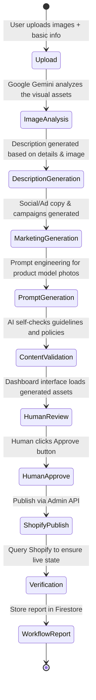

# AI Product Launch Platform (AI-PLP)

A production-ready, modular, and scalable platform that automates the process of analyzing, generating, validating, and publishing digital products to Shopify using Generative AI (Google Gemini) and Model Context Protocol (MCP).

---

## Architecture Overview

This project uses a strict separation between Frontend and Backend, following Clean Architecture principles:

- **Frontend**: Responsive React 19 application bundled with Vite, using Tailwind CSS, Shadcn UI, Zustand for state management, React Router, and Framer Motion.
- **Backend**: FastAPI (Python 3.12) codebase structured into distinct layers to separate business rules from technical details (frameworks, database adapters, and third-party APIs).

```
AI-PLP Root/
├── backend/                  # FastAPI Application
│   ├── app/
│   │   ├── core/            # Database init, configs, logging, security
│   │   ├── domain/          # Pure entity models & repository interfaces (Framework-agnostic)
│   │   ├── use_cases/       # Pipeline orchestrations & workflow application logic
│   │   ├── infrastructure/  # Firebase, Shopify, Gemini APIs & DB adapters (Adapters)
│   │   ├── interfaces/      # Routers, controllers, Pydantic schemas (Entrypoints)
│   │   └── main.py          # FastAPI application entrypoint
│   ├── tests/               # Test suites
│   ├── Dockerfile           # Backend deployment instructions
│   └── requirements.txt     # Backend Python packages
│
├── frontend/                 # React Application
│   ├── src/
│   │   ├── components/      # Shared layout components and Shadcn UI components
│   │   ├── hooks/           # Domain hooks & utilities
│   │   ├── pages/           # Pipeline page views (Upload, Review, Report, etc.)
│   │   ├── store/           # Zustand state management
│   │   ├── services/        # Axios API clients
│   │   └── main.tsx         # Root container script
│   ├── Dockerfile           # Frontend deployment instructions
│   └── package.json         # Package configuration
│
└── docker-compose.yml        # Development environment runner
```

---

## AI Product Launch Pipeline Workflow

The launch process follows a strict linear state machine to ensure content quality and user control:



---

## Tech Stack

| Component | Technology | Description |
|---|---|---|
| **Frontend** | React + Vite | Quick bundling & fast HMR |
| | Zustand | Lightweight client state manager |
| | Shadcn UI + Tailwind | Elegant components, accessible styling |
| | Framer Motion | Smooth state transitions and micro-interactions |
| | React Router v6 | Clientside path management |
| **Backend** | FastAPI | High-performance Python framework |
| | Pydantic v2 | Robust schema validations |
| | Firebase Admin SDK | Database access and file storage client |
| **AI Integration** | Google Gen AI SDK | Gemini 2.5/3.5 Flash support |
| | Model Context Protocol | External context/tool retrieval |
| **Deployment** | Docker | Consistent runtime environments |
| | GCP Cloud Run | Serverless execution for Backend container |
| | Firebase Hosting | Scalable global CDN for Frontend client |

---

## Getting Started

### Prerequisites
- Docker & Docker Compose
- Node.js 18+ (if running frontend locally without Docker)
- Python 3.12 (if running backend locally without Docker)

### Environment Setup
1. Copy the example environment file at the root:
   ```bash
   cp .env.example .env
   ```
2. Populate the parameters in `.env` with your Google Cloud credentials, Firebase app parameters, and Shopify API secret tokens.

### Running with Docker Compose
Run the following command in the root directory:
```bash
docker-compose up --build
```
- Frontend will be accessible at: `http://localhost:5173`
- Backend API Docs (Swagger) will be accessible at: `http://localhost:8000/docs`

---

## Deployment to Google Cloud

### Backend (Google Cloud Run)
1. Build and push backend image to GCP Artifact Registry:
   ```bash
   gcloud builds submit --tag gcr.io/YOUR_PROJECT_ID/ai-launch-backend ./backend
   ```
2. Deploy the container:
   ```bash
   gcloud run deploy ai-launch-backend --image gcr.io/YOUR_PROJECT_ID/ai-launch-backend --platform managed --allow-unauthenticated
   ```

### Frontend (Firebase Hosting)
1. Install Firebase CLI: `npm install -g firebase-tools`
2. Authenticate: `firebase login`
3. Initialize Firebase inside `frontend/` directory, choosing Hosting.
4. Build the application:
   ```bash
   cd frontend
   npm run build
   ```
5. Deploy:
   ```bash
   firebase deploy --only hosting
   ```
