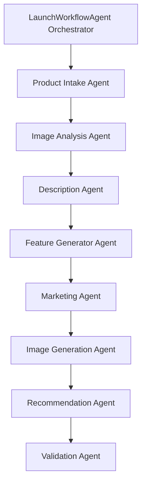

# Implementation Plan - AI Product Launch Studio

We are building an **AI Product Launch Studio** that models an internal catalog-automation tool for KiddyPi (Subhanu Technologies). 

The platform runs a unified multi-agent pipeline (`LaunchWorkflowAgent`), allows human reviewers to audit and edit generated data, publishes to a catalog (Shopify or local database), and immediately displays it in a consumer-facing **Demo Store** featuring dynamic recommendations.

---

## Proposed Changes

### 1. Backend Core & Entities

#### [MODIFY] [entities.py](file:///d:/AI-productLaunchAgent/backend/app/domain/entities.py)
* Add/extend fields to match the 8-agent output structure in `LaunchWorkflow`:
  * `features`: `FeatureResult` (Key Features, Specifications, What's Included, Highlights)
  * `generated_images`: `GeneratedImages` (Packshot, Lifestyle Scene, Promotional Banner)
  * `recommendations`: `List[ProductRecommendation]` (list of matching sample product dicts)
  * `validation`: `ValidationReport` (Validation Score, Grammar checks, Readability rating, Image quality, completeness, suggestions)

#### [MODIFY] [main.py](file:///d:/AI-productLaunchAgent/backend/app/main.py)
* Seed 20 KiddyPi sample products in Firestore (or in-memory mock if Firestore is offline) during server lifespan boot, split by `Programming` and `Electronics` categories for category-based matching.

---

### 2. AI Agents Architecture

Instead of isolated calls, we will orchestrate all agents under a single pipeline:

#### [NEW] [feature_generator/agent.py](file:///d:/AI-productLaunchAgent/backend/app/agents/feature_generator/agent.py)
* Extracts core features, box contents ("What's Included"), specifications, and highlights based on raw intake details and vision analysis.

#### [NEW] [image_generation/agent.py](file:///d:/AI-productLaunchAgent/backend/app/agents/image_generation/agent.py)
* Simulates or executes Vertex AI Imagen / Gemini image generation. Returns high-quality, category-specific URLs mapping to:
  1. A consistent product packshot
  2. A child-building lifestyle scene
  3. A promotional website banner

#### [NEW] [recommendation/agent.py](file:///d:/AI-productLaunchAgent/backend/app/agents/recommendation/agent.py)
* Scans Firestore/mock database for 20-30 seed products. Performs category-matching (e.g., Programming $\rightarrow$ Python/Scratch; Electronics $\rightarrow$ Arduino/Raspberry Pi) and returns recommended course/kit items.

#### [MODIFY] [orchestrator.py](file:///d:/AI-productLaunchAgent/backend/app/agents/workflow/orchestrator.py)
* Modify `execute_workflow` to run the 8 stages sequentially. Update the central workflow state file in Firestore at each step to support real-time progress bar updates in the UI.

---

### 3. Frontend Store & API Integration

#### [MODIFY] [useLaunchStore.ts](file:///d:/AI-productLaunchAgent/frontend/src/store/useLaunchStore.ts)
* Update store actions to hit the consolidated orchestrator or execute the extended stages.
* Map backend response properties (`features`, `generated_images`, `recommendations`) to state.
* Maintain a database of published products accessible to the Demo Store.

#### [NEW] [DemoStore.tsx](file:///d:/AI-productLaunchAgent/frontend/src/pages/DemoStore.tsx)
* Customer-facing storefront with a tech-kiddy UI.
* Product list showing published courses and kits.
* Detailed product page with a "Buy" button and category-matching "Related Products" suggestions.

#### [MODIFY] [HumanReview.tsx](file:///d:/AI-productLaunchAgent/frontend/src/pages/HumanReview.tsx)
* Redesign as the **Product Preview & Review Center**.
* Show uploaded images alongside AI-generated packshots, lifestyle scenes, and banners.
* Render the full copywriting outputs (Description, Specifications, FAQ, Learning Outcomes).
* Render marketing copies, hashtags, CTAs, validation safety scores, and related products recommendations.
* Allow inline edits to Description, Marketing posts, and Prompts before clicking "Publish".

#### [MODIFY] [Landing.tsx](file:///d:/AI-productLaunchAgent/frontend/src/pages/Landing.tsx)
* Style to look like KiddyPi (vibrant educational colors, cartoon/tech elements, rounded buttons). Contains Hero, features, pipeline visualization, and a Call-To-Action pointing to the Dashboard.

#### [MODIFY] [App.tsx](file:///d:/AI-productLaunchAgent/frontend/src/App.tsx)
* Register `/store` and `/store/product/:id` routes. Add quick links to the store.

---

## Verification Plan

### Automated Tests
* We will verify the backend build and test python server routes:
  `pytest backend/tests`
* Compile frontend:
  `npm run build` inside `frontend/`

### Manual Verification
* Upload a sample item in Dashboard (e.g., "Arduino IoT Rover Kit" or "Python Game Lab").
* Check loading screens and step-by-step agent indicators.
* Review generated images (Packshot, Lifestyle, Banner) and copy parameters in the Review workspace.
* Edit details, approve, and press **Publish**.
* Open the **Demo Store**, verify the new product is visible, click it, click "Buy", and verify the related products display matches the category.
